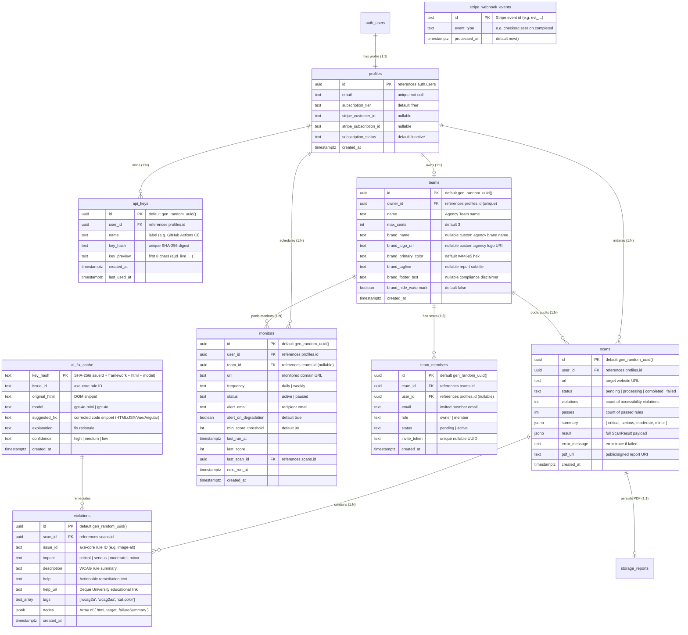

# Database Architecture & Schema Reference

> **Database Engine:** PostgreSQL 15+ (Supabase Managed Cloud)  
> **Security Model:** Row Level Security (RLS) on all public tables  
> **Replication:** Supabase Realtime WebSocket replication  
> **Storage:** Supabase Storage (`reports` private bucket)  
> **Status:** Active / Production Baseline

---

## 01 Entity-Relationship Diagram (ERD)



---

## 02 Table Specifications & Data Dictionaries

### 1. `public.profiles`
Stores subscription tier, billing linkage, and user metadata. Automatically populated upon sign-up via PostgreSQL database trigger.

```sql
create table public.profiles (
  id uuid references auth.users on delete cascade primary key,
  email text unique not null,
  subscription_tier text default 'free' not null check (subscription_tier in ('free', 'pro', 'agency')),
  stripe_customer_id text,
  stripe_subscription_id text,
  subscription_status text default 'inactive' not null,
  created_at timestamp with time zone default timezone('utc'::text, now()) not null
);
```

### 2. `public.scans`
The operational heartbeat of the system. Tracks asynchronous audit jobs, state transitions, summary scores, and detailed JSON results.

```sql
create table public.scans (
  id uuid default gen_random_uuid() primary key,
  user_id uuid references public.profiles(id) on delete cascade not null,
  team_id uuid references public.teams(id) on delete set null,
  url text not null,
  status text not null default 'pending' check (status in ('pending', 'processing', 'completed', 'failed')),
  violations int default 0 not null,
  passes int default 0 not null,
  summary jsonb, -- { critical: 0, serious: 0, moderate: 0, minor: 0 }
  result jsonb,  -- Full ScanResult structure with violations and incomplete items
  error_message text,
  pdf_url text,
  created_at timestamp with time zone default timezone('utc'::text, now()) not null
);
```

### 3. `public.teams`
Dedicated workspace grouping for Agency tier subscribers. Enforces a maximum of 3 multi-user seats.

```sql
create table public.teams (
  id uuid default gen_random_uuid() primary key,
  owner_id uuid references public.profiles(id) on delete cascade not null unique,
  name text not null default 'Agency Team',
  max_seats int not null default 3,
  brand_name text,
  brand_logo_url text,
  brand_primary_color text default '#4f46e5',
  brand_tagline text,
  brand_footer_text text,
  brand_hide_watermark boolean default false,
  created_at timestamp with time zone default timezone('utc'::text, now()) not null
);
```

### 4. `public.team_members`
Tracks seat allocation, invitations, and active team memberships under an agency workspace.

```sql
create table public.team_members (
  id uuid default gen_random_uuid() primary key,
  team_id uuid references public.teams(id) on delete cascade not null,
  user_id uuid references public.profiles(id) on delete cascade,
  email text not null,
  role text not null default 'member' check (role in ('owner', 'member')),
  status text not null default 'pending' check (status in ('pending', 'active')),
  invite_token text unique,
  created_at timestamp with time zone default timezone('utc'::text, now()) not null,
  unique(team_id, email)
);
```

### 5. `public.violations`
Stores granular, relational records of individual WCAG rules flagged during an audit (populated automatically by the `scan-site` Edge Function upon scan completion), enabling historical aggregate reporting.

```sql
create table public.violations (
  id uuid default gen_random_uuid() primary key,
  scan_id uuid references public.scans(id) on delete cascade not null,
  issue_id text not null,
  impact text not null check (impact in ('minor', 'moderate', 'serious', 'critical')),
  description text not null,
  help text not null,
  help_url text,
  tags text[] not null,
  nodes jsonb not null, -- Array of { html: string, target: string[], failureSummary: string }
  created_at timestamp with time zone default timezone('utc'::text, now()) not null
);
```

### 6. `public.api_keys`
Stores cryptographically hashed API tokens used for CI/CD pipelines and external integrations. Raw tokens are never stored.

```sql
create table public.api_keys (
  id uuid default gen_random_uuid() primary key,
  user_id uuid references public.profiles(id) on delete cascade not null,
  name text not null,
  key_hash text not null unique,
  key_preview text not null,
  created_at timestamp with time zone default timezone('utc'::text, now()) not null,
  last_used_at timestamp with time zone
);
```

### 7. `public.ai_fix_cache`
Shared deduplication layer for framework-aware AI-generated code remediations (`html`, `react-tailwind`, `vue`, `angular`).

```sql
create table public.ai_fix_cache (
  key_hash text primary key, -- SHA-256(issue_id + ":" + framework + ":" + original_html + ":" + model)
  issue_id text,
  original_html text,
  model text not null,
  suggested_fix text not null,
  explanation text not null,
  confidence text not null check (confidence in ('high', 'medium', 'low')),
  created_at timestamp with time zone default timezone('utc'::text, now()) not null
);
```

### 8. `public.monitors`
Stores scheduled recurring accessibility monitors configured for daily or weekly execution on critical URLs.

```sql
create table public.monitors (
  id uuid default gen_random_uuid() primary key,
  user_id uuid references public.profiles(id) on delete cascade not null,
  team_id uuid references public.teams(id) on delete set null,
  url text not null,
  frequency text not null check (frequency in ('daily', 'weekly')),
  status text not null default 'active' check (status in ('active', 'paused')),
  alert_email text not null,
  alert_on_degradation boolean default true not null,
  min_score_threshold int default 90 not null check (min_score_threshold between 1 and 100),
  last_run_at timestamp with time zone,
  last_score int,
  last_scan_id uuid references public.scans(id) on delete set null,
  next_run_at timestamp with time zone default timezone('utc'::text, now()) not null,
  created_at timestamp with time zone default timezone('utc'::text, now()) not null
);
```

### 9. `public.stripe_webhook_events`
Stores processed Stripe webhook event IDs to guarantee idempotent webhook processing and eliminate race conditions or replay attacks.

```sql
create table public.stripe_webhook_events (
  id text primary key,
  event_type text not null,
  processed_at timestamp with time zone default timezone('utc'::text, now()) not null
);
```

---

## 03 Row Level Security (RLS) Policies

All tables have RLS enabled by default. No client can access another tenant's audit data.

```sql
-- Profiles
alter table public.profiles enable row level security;
create policy "Users can view own profile" on public.profiles for select using (auth.uid() = id);
create policy "Users can update own profile" on public.profiles for update using (auth.uid() = id);

-- Scans
alter table public.scans enable row level security;
-- View own scans or scans belonging to active team
create policy "Users can view own or team scans" on public.scans for select using (
  auth.uid() = user_id or (
    team_id is not null and exists (
      select 1 from public.team_members
      where team_members.team_id = scans.team_id
        and team_members.user_id = auth.uid()
        and team_members.status = 'active'
    )
  )
);
create policy "Users can insert own scans" on public.scans for insert with check (auth.uid() = user_id);
create policy "Users can delete own scans" on public.scans for delete using (auth.uid() = user_id);
-- Edge Function service role override for updating scan progress and results
create policy "Service role can update scans" on public.scans for update using (true) with check (true);

-- Teams
alter table public.teams enable row level security;
create policy "Owners and members can view their team" on public.teams for select using (
  owner_id = auth.uid() or exists (
    select 1 from public.team_members
    where team_members.team_id = teams.id
      and team_members.user_id = auth.uid()
      and team_members.status = 'active'
  )
);
create policy "Agency owners can insert team" on public.teams for insert with check (
  owner_id = auth.uid() and exists (
    select 1 from public.profiles where profiles.id = auth.uid() and profiles.subscription_tier = 'agency'
  )
);
create policy "Owners can update own team" on public.teams for update using (owner_id = auth.uid());
create policy "Owners can delete own team" on public.teams for delete using (owner_id = auth.uid());

-- Team Members
alter table public.team_members enable row level security;
create policy "Team owners and members can view member list" on public.team_members for select using (
  exists (
    select 1 from public.teams
    where teams.id = team_members.team_id and (
      teams.owner_id = auth.uid() or exists (
        select 1 from public.team_members tm
        where tm.team_id = teams.id and tm.user_id = auth.uid() and tm.status = 'active'
      )
    )
  )
);
create policy "Team owners can insert members" on public.team_members for insert with check (
  exists (select 1 from public.teams where teams.id = team_members.team_id and teams.owner_id = auth.uid())
);
create policy "Team owners can update members" on public.team_members for update using (
  exists (select 1 from public.teams where teams.id = team_members.team_id and teams.owner_id = auth.uid())
);
create policy "Team owners or members themselves can delete membership" on public.team_members for delete using (
  user_id = auth.uid() or exists (
    select 1 from public.teams where teams.id = team_members.team_id and teams.owner_id = auth.uid()
  )
);

-- Violations
alter table public.violations enable row level security;
create policy "Users can view violations of own scans" on public.violations for select using (
  exists (select 1 from public.scans where scans.id = violations.scan_id and scans.user_id = auth.uid())
);
create policy "Users can insert violations of own scans" on public.violations for insert with check (
  exists (select 1 from public.scans where scans.id = violations.scan_id and scans.user_id = auth.uid())
);

-- API Keys
alter table public.api_keys enable row level security;
create policy "Users can view own API keys" on public.api_keys for select using (auth.uid() = user_id);
create policy "Users can insert own API keys" on public.api_keys for insert with check (auth.uid() = user_id);
create policy "Users can delete own API keys" on public.api_keys for delete using (auth.uid() = user_id);

-- AI Fix Cache (Global read/write for authenticated users)
alter table public.ai_fix_cache enable row level security;
create policy "Allow authenticated users to read cache" on public.ai_fix_cache for select to authenticated using (true);
create policy "Allow authenticated users to insert cache" on public.ai_fix_cache for insert to authenticated with check (true);

-- Scheduled Monitors
alter table public.monitors enable row level security;
create policy "Users can view own or team monitors" on public.monitors for select using (
  auth.uid() = user_id or (
    team_id is not null and exists (
      select 1 from public.team_members
      where team_members.team_id = monitors.team_id
        and team_members.user_id = auth.uid()
        and team_members.status = 'active'
    )
  )
);
create policy "Users can insert own monitors" on public.monitors for insert with check (auth.uid() = user_id);
create policy "Users can update own monitors" on public.monitors for update using (auth.uid() = user_id);
create policy "Users can delete own monitors" on public.monitors for delete using (auth.uid() = user_id);
create policy "Service role has full access to monitors" on public.monitors for all using (true) with check (true);

-- Stripe Webhook Events
alter table public.stripe_webhook_events enable row level security;
-- Service role client bypasses RLS; anon/authenticated roles have zero read/write access.

-- Recursion-Free Helper Functions (Security Definer)
-- Used by Teams, Team Members, Scans, and Monitors policies to prevent cyclic infinite recursion
create or replace function public.is_team_member(_team_id uuid, _user_id uuid)
returns boolean
language sql
security definer
set search_path = public
stable
as $$
  select exists (
    select 1 from public.team_members
    where team_id = _team_id
      and user_id = _user_id
      and status = 'active'
  );
$$;

create or replace function public.is_team_owner(_team_id uuid, _user_id uuid)
returns boolean
language sql
security definer
set search_path = public
stable
as $$
  select exists (
    select 1 from public.teams
    where id = _team_id
      and owner_id = _user_id
  );
$$;
```

---

## 04 Automated Functions & Triggers

### Automated User Provisioning
When a user authenticates via Supabase Auth (Magic Link), a trigger automatically initializes their row in `public.profiles` with the default `free` tier.

```sql
create or replace function public.handle_new_user()
returns trigger as $$
begin
  insert into public.profiles (id, email, subscription_tier)
  values (new.id, new.email, 'free');
  return new;
end;
$$ language plpgsql security definer;

create or replace trigger on_auth_user_created
  after insert on auth.users
  for each row execute procedure public.handle_new_user();
```

---

## 05 Performance Indexes & Replication

```sql
-- Fast API key lookup on every incoming CI/CD request
create index idx_api_keys_key_hash on public.api_keys (key_hash);

-- Fast user dashboard query performance
create index idx_scans_user_created on public.scans (user_id, created_at desc);

-- Realtime replication activation
alter publication supabase_realtime add table public.scans;

-- High-performance cron lookup for due monitors
create index idx_monitors_due on public.monitors (status, next_run_at) where status = 'active';
create index idx_monitors_user on public.monitors (user_id, created_at desc);

-- Fast lookup and retention pruning for Stripe webhook idempotency
create index if not exists idx_stripe_webhook_events_processed_at on public.stripe_webhook_events (processed_at desc);
```

---

## 06 Migration History

* `20260610000000_init_schema.sql`: Initial setup of `profiles`, `scans`, `violations`, and `handle_new_user` trigger.
* `20260610000001_billing_updates.sql`: Added Stripe subscription linkage columns to `profiles`.
* `20260610000002_async_scans.sql`: Added `status`, `error_message`, service role update policy, and Realtime publication.
* `20260612000000_create_reports_bucket.sql`: Provisioned private `reports` Supabase storage bucket.
* `20260612000001_api_keys.sql`: Created `api_keys` table with SHA-256 hash index and RLS.
* `20260612000002_ai_fix_cache.sql`: Added `ai_fix_cache` deduplication table.
* `20260613000000_team_access.sql`: Created `teams` and `team_members` tables, added `team_id` to `scans`, and configured multi-user seat RLS policies.
* `20260614000000_white_label_branding.sql`: Added `brand_name`, `brand_logo_url`, `brand_primary_color`, `brand_tagline`, `brand_footer_text`, and `brand_hide_watermark` columns to `public.teams`.
* `20260615000000_scheduled_monitors.sql`: Created `monitors` table with RLS, performance indexes, and foreign keys for automated recurring audits.
* `20260616000000_fix_rls_recursion.sql`: Security definer functions (`is_team_member`, `is_team_owner`) eliminating cyclic RLS recursion between `teams`, `team_members`, `scans`, and `monitors`.
* `20260617000000_stripe_webhook_events.sql`: Idempotency table for Stripe webhook events preventing duplicate processing and race conditions.
* `combined_pending_migrations.sql`: Master consolidated migration script combining all pending schema, RLS, and security updates for single-step database deployment.
* `phase2_cloud_verification.sql`: Verification script ensuring RLS is enabled and operational across all 9 public tables (`ai_fix_cache`, `api_keys`, `monitors`, `profiles`, `scans`, `stripe_webhook_events`, `team_members`, `teams`, `violations`).


